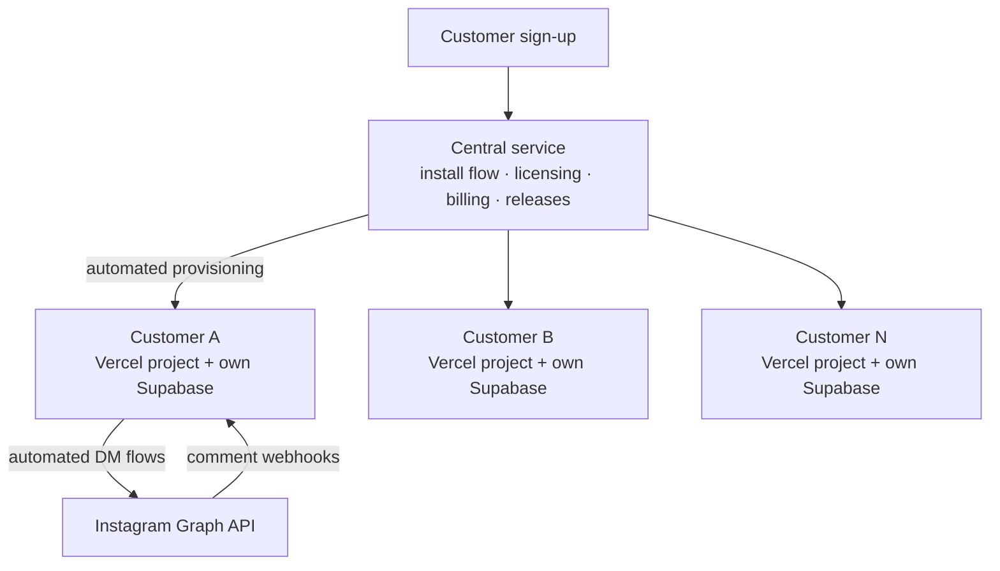

# MyOwnChat: Instagram DM Automation SaaS

> **Case study.** MyOwnChat is a commercial product, so its source code is private. This page explains
> what it does, how it is built, and the engineering decisions behind it.

**Live:** [myownchat.com.br](https://myownchat.com.br) · **Status:** in production with paying customers · **Role:** solo founder & full-stack developer

---

## The problem

Instagram sellers and creators get hundreds of comments like *"link?"* or *"price?"* on every post.
Answering each one by hand doesn't scale, and the leading tools charge per contact or per message,
so the bill grows exactly when a post goes viral.

## The solution

MyOwnChat watches comments on posts and stories and replies automatically with a personalized DM flow.
It charges a **flat monthly price with unlimited messages**.

**Main features**
- Comment → DM automations with keyword matching, per post or story
- Flow editor for multi-step message sequences with buttons and links
- Follow-gate: the content is only delivered after the user follows the account
- Lead capture (email / phone) with CSV export
- Click tracking and engagement dashboard
- Built on the **official Meta Graph API** with OAuth, webhooks and token refresh, not on scraping

## Architecture

**Single-tenant isolation, provisioned automatically.** Every customer runs on an isolated instance
with their own deployment, their own Postgres database and their own subdomain. The onboarding flow
connects the customer's database and then, in one idempotent pipeline:

1. creates the schema and a one-time first-access link (only a **hash** of the token is stored)
2. creates the storage bucket for images
3. creates the Vercel project and environment variables through the Vercel API
4. deploys, reusing files by SHA so new instances deploy fast
5. schedules `pg_cron` jobs in the customer's database
6. activates the license in the central service
7. **cleans up secrets**: database management credentials are deleted once provisioning is finished, and anything that has to remain is encrypted
8. sends the welcome email, only on the first run

The pipeline is **idempotent**. It can be re-run safely from the installer or from an admin "rescue" button without duplicating anything.

## Engineering highlights

- **Reliability:** scheduled jobs for token refresh, queue draining, health checks, latency monitoring and trial expiration, plus alerts to the operator.
- **Security:** 2FA on login, hashed one-time tokens, encrypted secrets at rest, audit log, and Meta data-deletion and deauthorize callbacks as required for app review.
- **Fleet updates:** releases are versioned in the central service and pushed to every customer instance.
- **Capacity planning:** Meta rate limits documented and stress-tested before scaling.
- **Billing:** payment-provider webhooks drive license activation, plans and coupons.

## Stack

`Next.js 16 (App Router)` `React 19` `TypeScript` `Tailwind CSS 4` `shadcn/ui / Radix` `Zod`
`Supabase` `PostgreSQL` `pg_cron` `Meta Graph API` `Vercel API` `Nodemailer` `Recharts`

## What I learned

- Designing **multi-tenant provisioning** that is idempotent and safe to retry
- Working within a strict third-party platform (Meta review, rate limits, webhook semantics)
- Treating secrets as a liability: keep only what is needed, encrypted
- Shipping and supporting a product for real paying customers

---

Built by **[Pedro Laterza](https://github.com/pedrolaterza)** · [LinkedIn](https://www.linkedin.com/in/pedrolaterza/)
